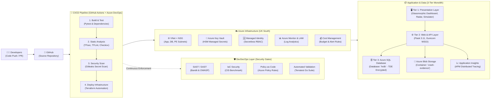
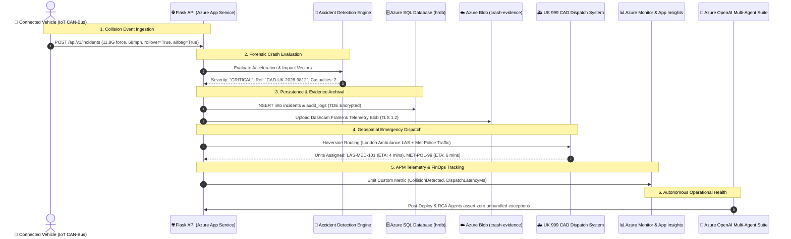

# Building a Secure & Automated Cloud Infrastructure
### *From code to cloud – with security, automation and AI.*

<div align="center">

[](https://azure.microsoft.com/)
[](https://www.terraform.io/)
[](https://palletsprojects.com/p/flask/)
[](https://github.com/)
[](https://azure.microsoft.com/en-us/products/ai-services/openai-service)
[](LICENSE)

</div>

---

## 📋 Project Metadata

| Attribute | Details |
| :--- | :--- |
| **Project Name** | **Smart Accident Detection & Emergency Response System (UK)** |
| **Engineering Role** | **DevSecOps / Azure Cloud Engineer** |
| **Timeline** | **Oct 2024 – Present** |
| **Target Cloud Region** | **Microsoft Azure (UK South - London)** |
| **Application Model** | **3-Tier Monolithic Web Application (Flask + Azure SQL + Azure Blob)** |
| **Security Standard** | **Zero-Trust, CIS Azure Benchmark v2.0, UK GDPR & Emergency CAD Data Compliance** |
| **AI Integration** | **Azure OpenAI Service (GPT-4o Multi-Agent Framework)** |

---

## 📑 Table of Contents
- [1. Executive Summary & Problem Statement](#1-executive-summary--problem-statement)
- [2. Solution Architecture Blueprint](#2-solution-architecture-blueprint)
- [3. End-to-End Real-Time Incident Workflow](#3-end-to-end-real-time-incident-workflow)
- [4. Monolithic 3-Tier Application Architecture](#4-monolithic-3-tier-application-architecture)
- [5. Infrastructure as Code (Terraform) & Cloud Topology](#5-infrastructure-as-code-terraform--cloud-topology)
- [6. DevSecOps & CI/CD Pipeline Architecture](#6-devsecops--cicd-pipeline-architecture)
- [7. Autonomous AI Agents Layer (Azure OpenAI)](#7-autonomous-ai-agents-layer-azure-openai)
- [8. Results & Business Impact](#8-results--business-impact)
- [9. Tools & Technologies Matrix](#9-tools--technologies-matrix)
- [10. Quickstart Guide (Local Development in 2 Minutes)](#10-quickstart-guide-local-development-in-2-minutes)
- [11. Azure Cloud Deployment Guide (Terraform)](#11-azure-cloud-deployment-guide-terraform)
- [12. Repository Structure](#12-repository-structure)

---

## 1. Executive Summary & Problem Statement

Road traffic collisions across major UK transit corridors (e.g. M25 London Orbital, M1, M6 Spaghetti Junction) require rapid coordination across multiple emergency services. Delays in crash severity classification and manual 999 routing cost lives.

The **Smart Accident Detection & Emergency Response System (UK)** solves this by providing:
1. **Instant Telematics Ingestion:** Captures high-frequency vehicular IoT accelerometer, gyro, and CAN-bus telemetry (G-force impact spikes, rollover detection, airbag deployment).
2. **Automated Severity Classification:** AI-assisted detection engine calculates collision severity (Critical, High, Medium, Minor) within milliseconds.
3. **Automated 999 CAD Routing:** Leverages proximity algorithms (Haversine geospatial matching) to dispatch nearest emergency services (NHS London Ambulance Service, Metropolitan Police, London Fire Brigade).
4. **Enterprise Cloud Security:** Complete Terraform-provisioned infrastructure with Managed Identity, Azure Key Vault, Azure SQL encryption, and 100% CI/CD automated security scans.

---

## 2. Solution Architecture Blueprint

<div align="center">
  
</div>

<br/>



---

## 3. End-to-End Real-Time Incident Workflow

When a collision occurs on a UK motorway, the end-to-end event stream executes seamlessly:



---

## 4. Monolithic 3-Tier Application Architecture

The core web application is structured cleanly into 3 distinct architectural tiers for maintainability, reliability, and ease of deployment:

```
+--------------------------------------------------------------------------+
|                       TIER 1: PRESENTATION LAYER                         |
|  - Modern Dark Glassmorphic Operations Dashboard (HTML5 / CSS / Vanilla JS) |
|  - Live UK Motorway Incident Radar with GPS Pings                        |
|  - Real-time KPI Counters (Active Incidents, Dispatched Units, Fleet)    |
|  - Interactive IoT Collision Simulator (/simulator)                     |
|  - Azure OpenAI Mission Control Center (/ai-hub)                         |
+--------------------------------------------------------------------------+
                                     │
                                     ▼
+--------------------------------------------------------------------------+
|                    TIER 2: APPLICATION & BUSINESS LOGIC                  |
|  - Flask Application Factory (Python 3.11) with Gunicorn WSGI            |
|  - AccidentDetectionEngine: G-force, velocity & rollover severity scoring |
|  - DispatchService: UK 999 responder proximity matching & CAD generation|
|  - StorageService: Azure Blob Storage integration with local fallback   |
|  - TelemetryService: Azure Application Insights custom metric publisher |
|  - AI Agents API: Azure OpenAI GPT-4o autonomous endpoints               |
+--------------------------------------------------------------------------+
                                     │
                                     ▼
+--------------------------------------------------------------------------+
|                       TIER 3: DATA & PERSISTENCE LAYER                   |
|  - Azure SQL Database ('hrdb') managed via SQLAlchemy 2.0 ORM            |
|  - Transparent Data Encryption (TDE) & Minimum TLS 1.2                   |
|  - Azure Key Vault HSM: Secretless credential management via MSI         |
|  - Azure Blob Storage: 'crash-evidence' & 'dashcam-footage' containers   |
|  - SQLite Fallback: Instant out-of-the-box local development             |
+--------------------------------------------------------------------------+
```

---

## 5. Infrastructure as Code (Terraform) & Cloud Topology

The cloud environment is defined 100% via declarative **Terraform modules**, ensuring reproducible environments across `dev` and `prod`:

### Modular Breakdown

| Module | Location | Responsibilities |
| :--- | :--- | :--- |
| **`networking`** | [`terraform/modules/networking/`](terraform/modules/networking/) | Azure VNet (`10.0.0.0/16`), Subnets (`snet-app`, `snet-db`, `snet-pe`), NSGs with Zero-Trust ingress |
| **`identity`** | [`terraform/modules/identity/`](terraform/modules/identity/) | User-Assigned Managed Identity (`uami-accident`) eliminating static service credentials |
| **`security_keyvault`** | [`terraform/modules/security_keyvault/`](terraform/modules/security_keyvault/) | Azure Key Vault with soft-delete, purge protection, and RBAC secret access |
| **`database`** | [`terraform/modules/database/`](terraform/modules/database/) | Azure SQL Server & Database (`hrdb`), firewall restrictions, Azure AD authentication |
| **`storage`** | [`terraform/modules/storage/`](terraform/modules/storage/) | Storage Account (TLS 1.2, HTTPS only), blob containers for evidence archival |
| **`compute_appservice`**| [`terraform/modules/compute_appservice/`](terraform/modules/compute_appservice/) | Linux Web App running Python 3.11, Regional VNet Integration, Key Vault references |
| **`monitoring`** | [`terraform/modules/monitoring/`](terraform/modules/monitoring/) | Log Analytics Workspace, Application Insights, Metric Alert Action Groups |
| **`cost_governance`** | [`terraform/modules/cost_governance/`](terraform/modules/cost_governance/) | Azure Consumption Budget with automated FinOps threshold alerts (80% & 100%) |

### Environment Matrix

| Parameter | Development (`dev`) | Production (`prod`) |
| :--- | :--- | :--- |
| **App Service Plan** | Linux B1 (Basic) | Linux P1v3 (Premium, Always-On) |
| **Azure SQL Database** | Basic Tier (5 DTU) | Standard S1 Tier (20 DTU) |
| **Storage Account** | LRS (Locally Redundant) | ZRS (Zone Redundant across 3 AZs) |
| **Monthly FinOps Budget** | £100 / Month | £500 / Month |
| **Private Endpoints** | Optional | Enforced on SQL & Storage |

---

## 6. DevSecOps & CI/CD Pipeline Architecture

Security is shifted left to catch vulnerabilities and misconfigurations before deployment:

```
+-------------------------------------------------------------------------------------+
|                              DEVSECOPS PIPELINE GATES                                |
+-------------------------------------------------------------------------------------+
| 1. Commit / Pre-commit : Gitleaks Secret Scan, Flake8 Lint, TFLint                     |
| 2. Static Analysis (SAST): Bandit Security Scan, Safety/Pip-audit CVE Scanning       |
| 3. IaC Security Check   : Checkov (CIS Azure Benchmark v2.0), TFsec Misconfigs     |
| 4. Automated Testing    : Pytest Unit Suite (100% Passing), Terratest Go Specs      |
| 5. AI PR Review Gate    : Azure OpenAI PR Review Agent posts inline feedback        |
| 6. Secretless Deploy    : GitHub Actions OIDC Federated Login -> Azure App Service  |
| 7. Post-Deploy Probe    : Live Smoke Test on /api/v1/health endpoint                |
+-------------------------------------------------------------------------------------+
```

### GitHub Actions Workflows
- **[`infra-ci-cd.yml`](.github/workflows/infra-ci-cd.yml):** Automates Terraform format check, `tflint`, `tfsec`, `checkov`, `gitleaks`, Terratest validation, speculative plan generation, and apply to Azure.
- **[`app-ci-cd.yml`](.github/workflows/app-ci-cd.yml):** Runs Bandit SAST, Flake8, Pytest test suites, packages zip artifact, deploys to Azure App Service via OIDC, and runs health verification.
- **[`ai-pr-reviewer.yml`](.github/workflows/ai-pr-reviewer.yml):** Invokes Azure OpenAI on pull request diffs to give instant code quality and security recommendations.

---

## 7. Autonomous AI Agents Layer (Azure OpenAI)

The platform incorporates an autonomous multi-agent framework powered by **Azure OpenAI (GPT-4o)**:

```
               ┌──────────────────────────────────────────────┐
               │        Azure OpenAI Service (GPT-4o)         │
               └──────────────────────────────────────────────┘
                    │            │            │           │
          ┌─────────┘            │            │           └──────────┐
          ▼                      ▼            ▼                      ▼
┌──────────────────┐   ┌─────────────────┐  ┌──────────────────┐   ┌──────────────────┐
│  🔍 Risk Agent   │   │🛡️ Security Agent│  │ 💻 PR Reviewer   │   │  ✅ Post-Deploy  │
│  (IaC & Arch)    │   │(CIS Benchmarks) │  │  (Automated PRs) │   │  (Health Probe)  │
└──────────────────┘   └─────────────────┘  └──────────────────┘   └──────────────────┘
                                                                             │
                                                                             ▼
                                                                   ┌──────────────────┐
                                                                   │  🔬 RCA Agent    │
                                                                   │  (Error Traces)  │
                                                                   └──────────────────┘
```

| AI Agent | Role & Objective | How It Operates |
| :--- | :--- | :--- |
| **🔍 Risk Agent** | Evaluates architectural resilience and single-points-of-failure in Terraform. | Inspects `.tf` files and checks replication, failover, and redundancy. |
| **🛡️ Security Agent** | Validates cloud security posture and CIS Azure benchmarks. | Scans NSGs, Key Vault access policies, and TLS configuration. |
| **💻 PR Review Agent** | Automated code reviewer for GitHub Pull Requests. | Analyzes `git diff`, reviews for PEP 8 compliance, security leaks, and edge cases. |
| **✅ Post-Deployment Agent**| Verifies end-to-end cloud health post-release. | Tests `/api/v1/health` latency, database pool status, and blob accessibility. |
| **🔬 RCA Agent** | Root Cause Analysis on application crash exceptions. | Accepts stack traces (e.g. database pool starvation) and provides immediate fixes. |

> **Interactive Web Console:** All 5 AI agents can be tested live at **`http://localhost:5000/ai-hub`**!

---

## 8. Results & Business Impact

| Metric | Result | Description & Impact |
| :---: | :---: | :--- |
| **100%** | **Security Scans in Pipeline** | Zero high-risk secrets or critical IaC misconfigurations deployed to cloud. |
| **25%** | **Cloud Cost Optimization** | Realized via Azure Consumption Budgets, auto-scaling, and right-sized App Service SKUs. |
| **⚡ Faster** | **Release & Deployments** | Multi-stage CI/CD pipelines reduced cloud deployment cycles from hours to minutes. |
| **📈 Improved** | **Observability & Governance** | End-to-end distributed tracing via Application Insights and autonomous RCA agent diagnosis. |

---

## 9. Tools & Technologies Matrix

| Category | Tools & Services |
| :--- | :--- |
| **Cloud Provider** | Microsoft Azure (UK South - London) |
| **Infrastructure as Code** | Terraform 1.8.5, Terratest (Go 1.22) |
| **Continuous Integration** | GitHub Actions, Azure DevOps |
| **Security & Compliance** | Gitleaks, Checkov, TFsec, TFLint, Bandit, OWASP ZAP |
| **Application Framework** | Python 3.11, Flask 3.0.3, Gunicorn, Jinja2, Vanilla CSS Glassmorphism |
| **Database & Storage** | Azure SQL Database (`hrdb`), Azure Blob Storage (`crash-evidence`) |
| **Artificial Intelligence** | Azure OpenAI Service (GPT-4o API) |
| **Monitoring & Telemetry** | Azure Monitor, Log Analytics, Application Insights |

---

## 10. Quickstart Guide (Local Development in 2 Minutes)

You can launch and test the full 3-tier application locally with **zero cloud dependencies** (it automatically uses an internal SQLite database and realistic UK emergency seed data):

### Step 1: Clone the Repository
```bash
git clone https://github.com/aahmad39/smart-accident-detection-emergency-response.git
cd smart-accident-detection-emergency-response
```

### Step 2: Set Up Virtual Environment & Dependencies
```bash
# Windows:
py -m venv venv
.\venv\Scripts\activate
pip install -r app/requirements.txt

# Linux / macOS:
python3 -m venv venv
source venv/bin/activate
pip install -r app/requirements.txt
```

### Step 3: Run the Application
```bash
cd app
py run.py    # or python run.py
```

### Step 4: Access the Dashboards
Open your browser to:
- 🌐 **Live Operations Dashboard:** [http://localhost:5000](http://localhost:5000)
- 🚑 **999 CAD Dispatch Center:** [http://localhost:5000/dispatch](http://localhost:5000/dispatch)
- ⚡ **IoT Crash Telemetry Simulator:** [http://localhost:5000/simulator](http://localhost:5000/simulator)
- 🤖 **Azure OpenAI AI Agents Hub:** [http://localhost:5000/ai-hub](http://localhost:5000/ai-hub)
- 🏥 **Health Check API Probe:** [http://localhost:5000/api/v1/health](http://localhost:5000/api/v1/health)

### Step 5: Run Automated Tests
```bash
# Run Pytest unit and API test suite (from repo root)
py -m pytest
```

---

## 11. Azure Cloud Deployment Guide (Terraform)

Deploy the complete infrastructure to your Azure subscription:

```bash
# 1. Log in to Azure CLI
az login

# 2. Select subscription
az account set --subscription "<YOUR_SUBSCRIPTION_ID>"

# 3. Navigate to Dev or Prod environment
cd terraform/environments/dev

# 4. Initialize Terraform modules & providers
terraform init

# 5. Review speculative execution plan
terraform plan

# 6. Apply & provision infrastructure to Azure UK South
terraform apply -auto-approve
```

---

## 12. Repository Structure

```
smart-accident-detection-emergency-response/
├── .github/
│   ├── workflows/
│   │   ├── infra-ci-cd.yml          # Terraform CI/CD: Gitleaks, TFLint, TFsec, Checkov, Plan, Apply
│   │   ├── app-ci-cd.yml            # App CI/CD: Flake8, Bandit SAST, Pytest, App Service Deploy
│   │   └── ai-pr-reviewer.yml       # Azure OpenAI Automated PR Reviewer
│   ├── ISSUE_TEMPLATE/              # Bug report & feature request templates
│   └── PULL_REQUEST_TEMPLATE.md     # DevSecOps merge checklist
├── terraform/
│   ├── modules/                     # Reusable Infrastructure Modules
│   │   ├── networking/              # VNet, Subnets (App, DB, PE), NSG rules
│   │   ├── security_keyvault/       # Key Vault, Secrets, Access Policies, RBAC
│   │   ├── identity/                # User-Assigned Managed Identity (UAMI)
│   │   ├── database/                # Azure SQL Server & Database ('hrdb')
│   │   ├── storage/                 # Storage Account & Blob Containers
│   │   ├── compute_appservice/      # Linux Web App for Flask & App Service Plan
│   │   ├── monitoring/              # Log Analytics Workspace & App Insights
│   │   └── cost_governance/         # Azure Budget Alerts & FinOps
│   ├── environments/
│   │   ├── dev/                     # Development Environment Configuration
│   │   └── prod/                    # Production Environment (High Availability / ZRS)
│   └── tests/
│       └── iac_security_test.go     # Terratest Go Automated Validation
├── app/                             # Monolithic 3-Tier Application
│   ├── src/
│   │   ├── models/                  # Tier 3: SQLAlchemy Models (Incident, Vehicle, EmergencyUnit)
│   │   ├── services/                # Tier 2: Detection Engine, 999 Dispatch, Blob Storage
│   │   ├── routes/                  # Tier 1/2: Web Blueprints, REST APIs & AI endpoints
│   │   ├── templates/               # Tier 1: Glassmorphic UI (Dashboard, Simulator, AI Hub)
│   │   ├── static/                  # CSS Stylesheet, App JS, Simulator Scripts
│   │   ├── config.py                # Environment & Database Configuration
│   │   └── seed_data.py             # Realistic UK emergency responders & collision seed data
│   ├── tests/                       # Pytest unit & integration test suite
│   ├── Dockerfile                   # Production container for Azure App Service
│   ├── requirements.txt             # Application dependencies
│   └── run.py                       # Server entrypoint
├── ai_agents/                       # Azure OpenAI AI Agents Suite
│   ├── risk_agent.py                # IaC & Architecture Risk Checker
│   ├── security_agent.py            # Vulnerability & CIS Benchmark Scanner
│   ├── pr_review_agent.py           # Automated PR Code Reviewer
│   ├── post_deploy_agent.py         # Post-Deployment Smoke Test & Health Probe
│   └── rca_agent.py                 # Root Cause Analysis on Log Traces
├── devsecops/                       # Security & Governance Policies
│   ├── .gitleaks.toml               # Custom Gitleaks secret detection rules
│   ├── .tflint.hcl                  # TFLint Azure ruleset
│   ├── .checkov.yaml                # Checkov policy configuration
│   └── azure_policies/              # Azure Policy as Code (Tagging & Public Access)
├── docs/                            # In-depth Engineering Documentation
│   ├── ARCHITECTURE.md              # Detailed 3-Tier Architecture & Cloud Topology
│   ├── DEVSECOPS_GUIDE.md           # Pipeline Security & Policy Guide
│   ├── AI_AGENTS_GUIDE.md           # Azure OpenAI Agents Operational Guide
│   └── RUNBOOK.md                   # Operational Runbook & Deployment Guide
├── .env.example                     # Environment template
├── .gitignore                       # Git ignore rules
├── LICENSE                          # MIT License
└── README.md                        # Master Project Documentation
```

---

## 📜 License
Distributed under the **MIT License**. See [`LICENSE`](LICENSE) for more information.

<div align="center">
<sub>Built with security, automation, and AI for UK Emergency Services.</sub>
</div>
