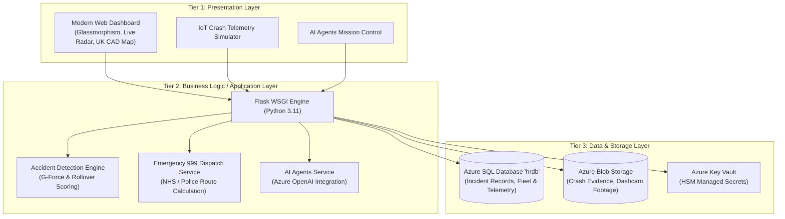

# Solution Architecture Specification

## Project: Smart Accident Detection & Emergency Response System (UK)
**Role:** DevSecOps / Azure Cloud Engineer  
**Architecture Model:** Monolithic 3-Tier Application with DevSecOps & AI Automation

---

## 1. Executive Summary
The **Smart Accident Detection & Emergency Response System (UK)** is an enterprise-grade cloud architecture designed to detect severe vehicular collisions in real time, extract forensic telematics (impact G-force, speed, rollover detection, airbag deployment), and coordinate rapid dispatch across UK emergency services (NHS Ambulance, Metropolitan & Regional Police, Fire & Rescue Service).

Built according to the **Azure Well-Architected Framework**, it integrates **Terraform Infrastructure as Code (IaC)**, automated **DevSecOps security gates**, and **Azure OpenAI AI Agents** for proactive risk analysis, automated pull request reviews, and root cause diagnosis.

---

## 2. 3-Tier Monolithic Application Architecture

### Tier 1: Presentation Layer
- **Framework:** HTML5, Jinja2, Vanilla CSS with custom glassmorphic styling, responsive grid layouts, and JavaScript.
- **Key Modules:**
  - Real-Time Command Dashboard (`index.html`) with KPI counters and live UK incident radar.
  - Incident Registry (`incidents.html`) with filtering by severity (Critical, High, Medium, Minor) and status.
  - Collision Telemetry & Forensic Inspector (`incident_detail.html`) showing tri-axial accelerometer forces and owner emergency contacts.
  - Emergency CAD Dispatch Station (`dispatch.html`) tracking responder units (London Ambulance LAS, Met Police, London Fire Brigade LFB).
  - Vehicle Telematics Crash Simulator (`simulator.html`) allowing manual or preset crash telemetry injection.
  - AI Agents Operations Room (`ai_hub.html`) executing Risk, Security, PR, and RCA agents.

### Tier 2: Application / Business Logic Layer
- **Framework:** Python Flask (Application Factory pattern), Gunicorn WSGI container.
- **Engines:**
  - `AccidentDetectionEngine`: Evaluates accelerometer spikes, impact velocity, and rollover status according to UK Road Safety standards to calculate collision severity.
  - `DispatchService`: Automatically queries available emergency units within proximity using the Haversine formula and schedules immediate priority dispatch.
  - `StorageService`: Seamlessly manages Azure Blob Storage uploads for accident evidence and dashcam frames with local fallback for testing.
  - `TelemetryService`: Transmits telemetry events and custom business KPIs to Azure Application Insights.

### Tier 3: Data & Persistence Layer
- **Database Engine:** Azure SQL Database (`hrdb`), managed with SQLAlchemy ORM.
- **Storage:** Azure Blob Storage container (`crash-evidence`, `dashcam-footage`) with TLS 1.2 and container-level immutability.
- **Security & Secrets:** Azure Key Vault storing SQL connection strings and cryptographic keys; zero credentials in source code.

---

## 3. Azure Cloud Infrastructure Components

| Azure Component | Resource Name | Role & Specification |
| :--- | :--- | :--- |
| **Virtual Network** | `vnet-accident-prod` | `10.0.0.0/16` with subnets for App (`10.0.1.0/24`), DB (`10.0.2.0/24`), and Private Endpoints (`10.0.3.0/24`) |
| **Network Security Group** | `nsg-app-prod` | Enforces Zero-Trust; permits inbound HTTPS (443) and load balancer probes, denies all other ingress |
| **App Service Plan** | `asp-accident-prod` | Linux App Service (P1v3 for Prod, B1 for Dev) |
| **Web App** | `app-accident-prod` | Hosts the 3-tier monolithic Flask application |
| **Azure SQL Server** | `sql-accident-prod` | Managed SQL with Azure AD / Managed Identity authentication, TDE, and minimum TLS 1.2 |
| **Azure SQL DB** | `hrdb` | Houses relational data (Incidents, Vehicles, Dispatches, Audits) |
| **Storage Account** | `staccidentprod` | Zone-Redundant Storage (ZRS) storing crash telemetry blobs and evidence images |
| **Key Vault** | `kv-accident-prod` | Soft-delete and purge protection enabled; RBAC `Key Vault Secrets User` |
| **Managed Identity** | `uami-accident-prod` | User-Assigned Managed Identity providing secretless resource access |
| **Log Analytics & App Insights** | `log-accident-prod` / `appi-accident-prod` | Distributed tracing, application performance monitoring (APM), and custom metrics |
| **Cost Management Budget** | `budget-accident-prod` | FinOps budget alerting at 80% forecast and 100% actual spend |

---

## 4. Disaster Recovery & High Availability
- **Resilience:** Multi-AZ deployment in Azure UK South.
- **Database Backup:** Point-in-time restore (PITR) up to 35 days enabled.
- **Blob Storage:** Zone-Redundant Storage (ZRS) protects against single-datacenter loss.
- **Health Probes:** Integrated health probe at `/api/v1/health` with automatic instance replacement.
